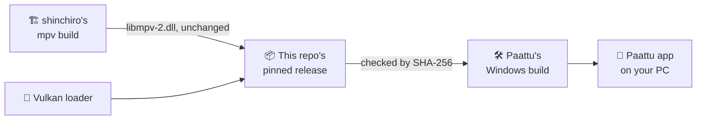

<h1 align="center">
  <br>
  <a href="https://github.com/sudharamachandranrajeev/paattu"></a>
  <br>
  paattu-libmpv
  <br>
</h1>

<h4 align="center">The pinned video and audio player library that the Paattu Windows app ships, with its full set of sound filters.</h4>

<p align="center">
  <a href="https://github.com/sudharamachandranrajeev/paattu-libmpv/releases"></a>
  
  <a href="https://github.com/sudharamachandranrajeev/paattu"></a>
</p>

<p align="center">
  <a href="#-whats-inside">What's inside</a> •
  <a href="#-use">Use</a> •
  <a href="#-how-it-works">How it works</a> •
  <a href="#-faq">FAQ</a> •
  <a href="#%EF%B8%8F-for-maintainers">For maintainers</a>
</p>

This repository holds one thing: a fixed copy of libmpv (the library inside the mpv player) for
the [Paattu](https://github.com/sudharamachandranrajeev/paattu) music app on Windows. It is not an
app, and you do not need it to use Paattu: the Windows installer already includes it. It contains
no code of its own; the files are unchanged from their makers.

## ✨ What's inside

Each release has one zip, `libmpv-windows-x86_64-<date>.zip`, with these files:

| File | What it is | Where it comes from | Licence |
| --- | --- | --- | --- |
| `libmpv-2.dll` | mpv's library with FFmpeg (the audio and video decoders and filters) | shinchiro's build, unchanged (see below) | GPL / LGPL, see [mpv's Copyright](https://github.com/mpv-player/mpv/blob/master/Copyright) |
| `vulkan-1.dll` | the Khronos Vulkan loader 1.3.296.0 (LunarG VulkanRT components). `libmpv-2.dll` needs it to load. | LunarG VulkanRT | Apache-2.0 (`vulkan-1-LICENSE.txt`) |
| `vulkan-1-LICENSE.txt` | the Vulkan loader's licence | | |
| `README.txt` | where each file came from | | |

**Where `libmpv-2.dll` comes from, exactly:**

- Archive: `mpv-dev-x86_64-20261017-git-dde0671072.7z` from
  [shinchiro's mpv-winbuild-cmake release 20261017](https://github.com/shinchiro/mpv-winbuild-cmake/releases/tag/20261017).
- Archive SHA-256: `d6638b2b40561e6071627f39ad60a38e15721dc87a49f244b897911ea2edfd9f`.
- Built from [mpv](https://github.com/mpv-player/mpv) commit `dde0671072`, and the FFmpeg and
  libraries listed in [mpv-winbuild-cmake](https://github.com/shinchiro/mpv-winbuild-cmake)
  (`packages/`), whose source that build script fetches.

## 🚀 Use

### Step 1 – Download

Open the [releases page](https://github.com/sudharamachandranrajeev/paattu-libmpv/releases) and take
the zip under the newest release:

| Release | File | SHA-256 of the zip |
| --- | --- | --- |
| `2026-10-17` (mpv `dde0671072`) | `libmpv-windows-x86_64-20261017.zip` (about 45 MB) | `205b7f06d17c492655b5d4a98d03644badbef07ce27a91c632f2f54438c5e164` |

### Step 2 – Check it

On Windows, in PowerShell:

```powershell
Get-FileHash libmpv-windows-x86_64-20261017.zip -Algorithm SHA256
```

The result must match the SHA-256 in the table. If it does not, do not use the file.

### Step 3 – Put it next to the app

Unzip it, and copy `libmpv-2.dll` and `vulkan-1.dll` into the same folder as the app's `.exe`.
Paattu's Windows build does this for you. Its `app/windows/CMakeLists.txt` downloads the zip, checks
the SHA-256 above, and installs the two DLLs after the plugins' own libraries, so they win. It also
copies `README.txt` and `vulkan-1-LICENSE.txt` into the app's `data/libmpv` folder.

## 🧭 How it works



- **Pinned, not "latest".** Paattu asks for one exact file and checks its fingerprint, so a new
  upstream build can never slip in unnoticed.
- **Unchanged.** The DLLs are byte-for-byte what their makers published.
- **Why it exists.** media_kit (the player package Paattu uses) ships a libmpv with only FFmpeg's
  `equalizer` audio filter. Paattu's surround needs `extrastereo`, so Paattu ships this build
  instead.

## ❓ FAQ

<details>
<summary><b>Do I need to download this to use Paattu?</b></summary>

No. The Paattu installer and portable zip for Windows already include these files. This repository
is for people who build Paattu, or who want to check what it ships.
</details>

<details>
<summary><b>Is anything changed or added?</b></summary>

No. `libmpv-2.dll` is unchanged from shinchiro's archive, and `vulkan-1.dll` is the stock loader.
This repository adds only the zip and the notes saying where each file came from.
</details>

<details>
<summary><b>Where is the source code?</b></summary>

mpv's is at [mpv-player/mpv](https://github.com/mpv-player/mpv) (commit `dde0671072`). The build
script and the list of FFmpeg and other libraries are at
[shinchiro/mpv-winbuild-cmake](https://github.com/shinchiro/mpv-winbuild-cmake), which fetches
their source.
</details>

<details>
<summary><b>Is there a Linux, macOS or 32-bit build?</b></summary>

No. Only 64-bit Windows needs it. Paattu on Linux uses the system's mpv, or the one inside the
AppImage.
</details>

## 🛠️ For maintainers

<details>
<summary>Moving Paattu to a newer libmpv</summary>

1. Pick a newer `mpv-dev-x86_64-…7z` from
   [shinchiro's releases](https://github.com/shinchiro/mpv-winbuild-cmake/releases). Note its
   SHA-256 and the mpv commit in its name.
2. Take `libmpv-2.dll` from it unchanged. Add `vulkan-1.dll` and its licence.
3. Write `README.txt` with the archive name, link, SHA-256 and mpv commit, as in the current one.
4. Zip the four files as `libmpv-windows-x86_64-<date>.zip` and publish a release tagged `<date>`.
5. In Paattu, update `PAATTU_LIBMPV`, the download URL and `PAATTU_LIBMPV_SHA256` in
   `app/windows/CMakeLists.txt`. Let Paattu's release workflow build and start the Windows app.

</details>

## Related

| Project | What it is |
| --- | --- |
| [paattu](https://github.com/sudharamachandranrajeev/paattu) | The Malayalam and Tamil music app that ships this library |
| [mpv](https://github.com/mpv-player/mpv) | The player the library comes from |
| [mpv-winbuild-cmake](https://github.com/shinchiro/mpv-winbuild-cmake) | The Windows build used here |

## License

This repository adds no code of its own. Each file keeps its makers' licence: mpv and FFmpeg are
under the GPL / LGPL (see [mpv's Copyright](https://github.com/mpv-player/mpv/blob/master/Copyright)),
and the Vulkan loader is under Apache-2.0 (`vulkan-1-LICENSE.txt` in the zip).

---

> GitHub [@sudharamachandranrajeev](https://github.com/sudharamachandranrajeev)
